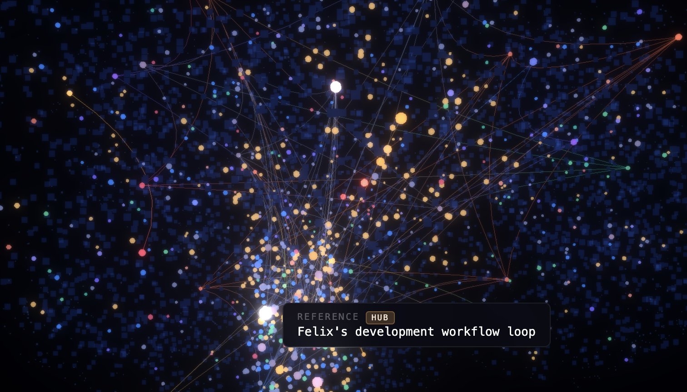

# context-vault

[](https://www.npmjs.com/package/context-vault)
[](./LICENSE)
[](https://nodejs.org)

Persistent memory for AI agents — save and search knowledge across sessions. Data stays local as markdown files.

> **Hosted tier** — cloud sync, web dashboard, team sharing → [app.context-vault.com](https://app.context-vault.com)

<p align="center">
  
</p>
<p align="center"><em>Vault Brain — your knowledge as a living neural network</em></p>

## Quick Start

```bash
curl -fsSL https://raw.githubusercontent.com/fellanH/context-vault/main/install.sh | sh
context-vault setup
```

No Node required — this installs the native binary directly. Windows: `irm https://raw.githubusercontent.com/fellanH/context-vault/main/install.ps1 | iex`.

Already have Node? `npx context-vault` works too and runs the same native engine under the hood.

Setup (~2 min) detects your AI tools (Claude Code, Cursor, Codex, Windsurf, etc.), configures MCP, downloads the embedding model (~22MB), and seeds a starter entry. The server runs as a shared daemon — all AI sessions share one auto-updating process.

Then **restart your AI tool** (required to pick up the new MCP server) and try:

> **"Search my vault for getting started"**

The vault lives at `~/vault/` — plain markdown files you own.

## What It Does

- **Save** — Insights, decisions, patterns, contacts. Your AI agent writes them as you work.
- **Search** — Hybrid full-text + semantic search. Ask in natural language.
- **Own your data** — Markdown in folders you control. Git-versioned, human-editable.

## First Steps

| Tell your AI                                             | What happens                             |
| -------------------------------------------------------- | ---------------------------------------- |
| "Save an insight: React Query's staleTime defaults to 0" | Creates `~/vault/knowledge/insights/...` |
| "Search my vault for React Query"                        | Returns matching entries                 |
| "List my recent decisions"                               | Browses entries by kind                  |
| "Show my vault status"                                   | Diagnostics and health                   |

## MCP Tools

Your AI agent uses these automatically — you don't call them directly.

**Core**

| Tool             | Description                                               |
| ---------------- | --------------------------------------------------------- |
| `get_context`    | Search vault — hybrid full-text + semantic vector search  |
| `save_context`   | Save or update entries (insights, decisions, patterns...) |
| `list_context`   | Browse entries with filters (kind, tags, date range)      |
| `delete_context` | Remove an entry by ID                                     |

**Ingest**

| Tool             | Description                                                             |
| ---------------- | ----------------------------------------------------------------------- |
| `ingest_url`     | Fetch a URL, extract readable content, save as a vault entry            |
| `ingest_project` | Scan a local project directory (package.json, README, git, tech stack) |

**Session**

| Tool              | Description                                                                          |
| ----------------- | ------------------------------------------------------------------------------------ |
| `session_end`     | Capture a session summary + discoveries as vault entries                             |
| `create_snapshot` | Compile vault entries on a topic into a single structured brief                      |

**System**

| Tool             | Description                                                     |
| ---------------- | --------------------------------------------------------------- |
| `context_status` | Vault health — config, file counts, database size, issues       |
| `list_buckets`   | List entries tagged as bucket entities                          |

**Buckets aren't a separate structure** — they're a `bucket:<name>` tag applied to entries for
scoping (any tool filtering by `buckets: [...]` is filtering on this tag). `ingest_project`
creates an optional `kind: bucket` entry as a discoverable index card for one, but the tag alone
is what does the scoping — nothing enforces the two stay in sync.

Kinds: `insight` · `decision` · `pattern` · `reference` · `contact` — or any custom kind. Derived from vault subdirectory names.

## CLI Reference

| Command                          | Description                                               |
| -------------------------------- | --------------------------------------------------------- |
| `context-vault setup`            | Interactive installer — detects tools, writes MCP configs |
| `context-vault ui [--port 3141]` | Web dashboard                                             |
| `context-vault status`           | Vault health, paths, entry counts                         |
| `context-vault reindex`          | Rebuild search index                                      |
| `context-vault import <path>`    | Import .md, .csv, .json, .txt                             |
| `context-vault export`           | Export to JSON or CSV                                     |
| `context-vault update`           | Check for updates                                         |
| `context-vault uninstall`        | Remove MCP configs                                        |

> **Note:** `context-mcp` is an alias; `context-vault` is the primary command.

## Hosted Option

Cloud sync, web dashboard, and team sharing at [app.context-vault.com](https://app.context-vault.com) — no Node.js required. Setup for Claude Code, Cursor, GPT Actions: [docs/distribution/connect-in-2-minutes.md](docs/distribution/connect-in-2-minutes.md)

## Configuration

Defaults work out of the box:

| Setting   | Default                   |
| --------- | ------------------------- |
| Vault dir | `~/vault/`                |
| Data dir  | `~/.context-mcp/`         |
| Database  | `~/.context-mcp/vault.db` |

Config: `~/.context-mcp/config.json`. Env vars: `CONTEXT_VAULT_VAULT_DIR`, `CONTEXT_VAULT_DB_PATH`, etc.

## Requirements

None, via `install.sh`/`install.ps1` — it's a native binary. `npx context-vault` additionally needs Node.js 18+ (see below).

| Platform | Install Node.js 18+ (only needed for the npx path) |
| -------- | ---------------------------------------------------- |
| **macOS** | `brew install node` or [nvm](https://github.com/nvm-sh/nvm): `nvm install 22` |
| **Windows** | `winget install OpenJS.NodeJS.LTS` or [nvm-windows](https://github.com/coreybutler/nvm-windows) |
| **Linux** | [nvm](https://github.com/nvm-sh/nvm): `nvm install 22` or [NodeSource](https://github.com/nodesource/distributions) |

## Troubleshooting

- **Install fails (native modules):** `npm rebuild sqlite-vec`
- **Vault not found:** `mkdir -p ~/vault && context-vault setup`
- **Stale search results:** `context-vault reindex`

## Feedback & Community

- **Questions or ideas?** [Discussions](https://github.com/fellanH/context-vault/discussions)
- **Found a bug?** [Open an issue](https://github.com/fellanH/context-vault/issues/new/choose)
- **Using context-vault?** [Show & Tell](https://github.com/fellanH/context-vault/discussions/categories/show-and-tell)

## Development

```bash
git clone https://github.com/fellanH/context-vault.git
cd context-vault
nvm use
npm install
npm run cli -- setup
```

Use `npx context-vault` or `npm run cli --` instead of `context-vault` when running from source.

## License

MIT
